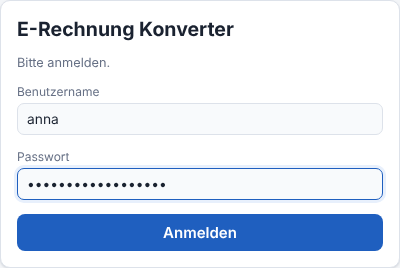
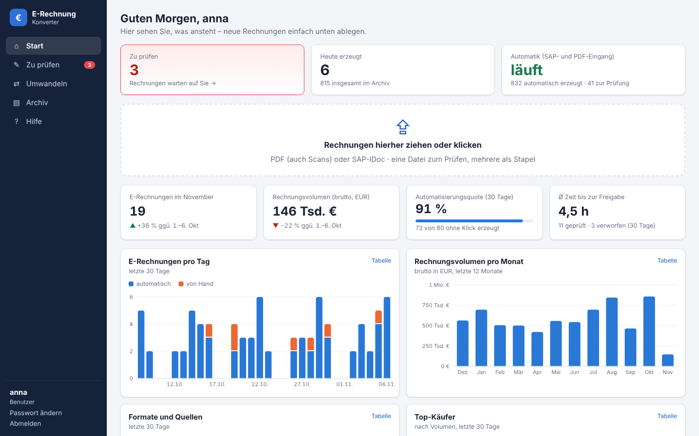
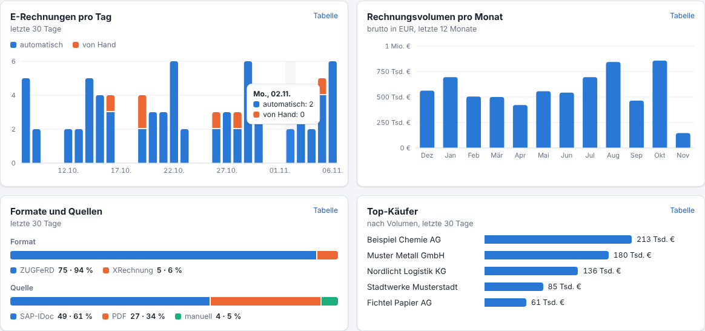
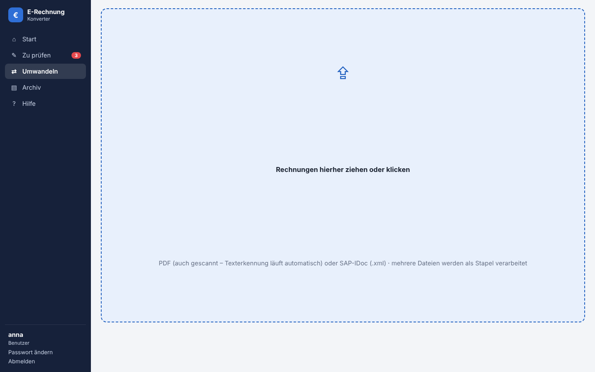
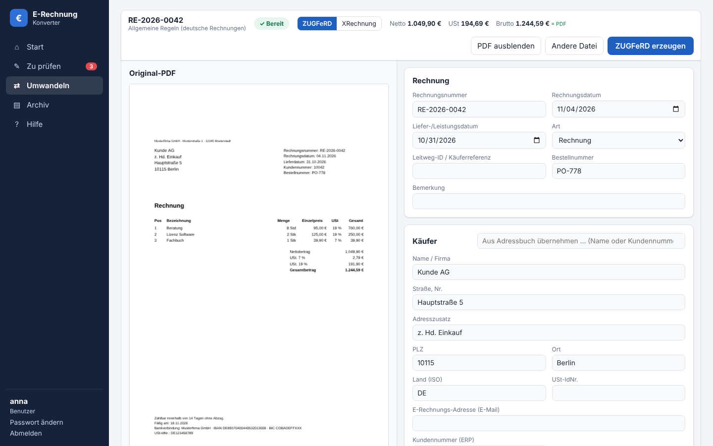
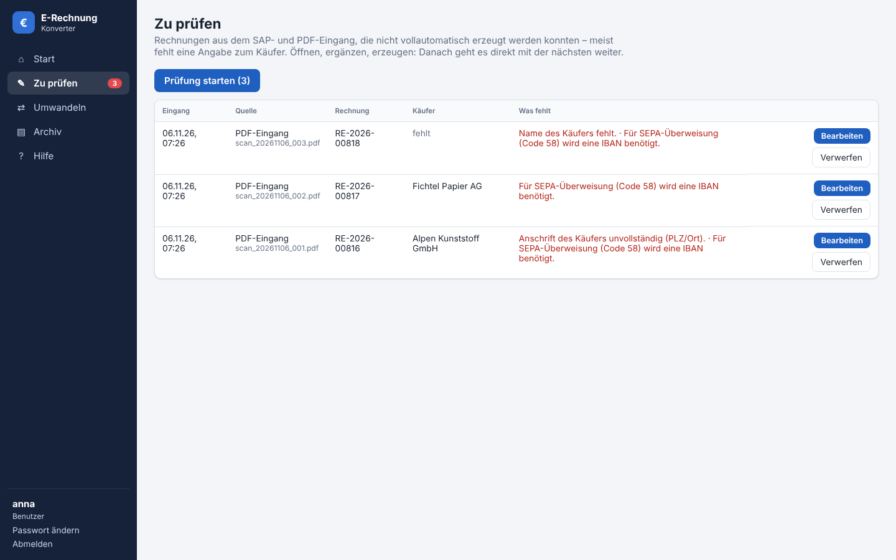
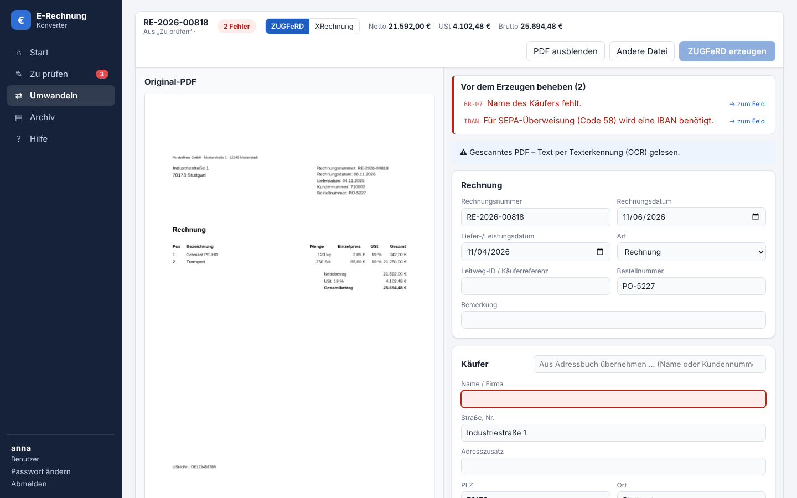
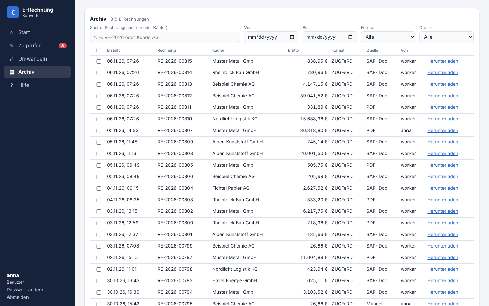
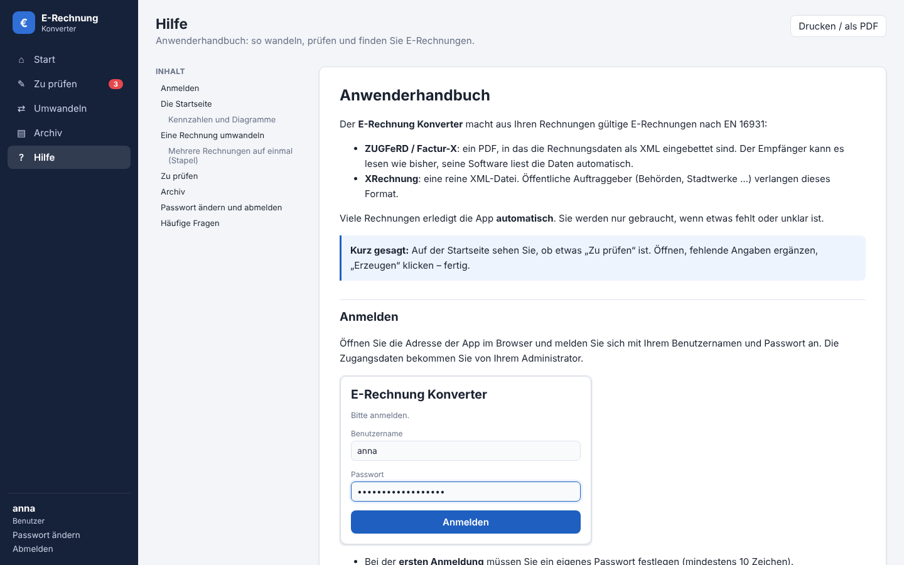
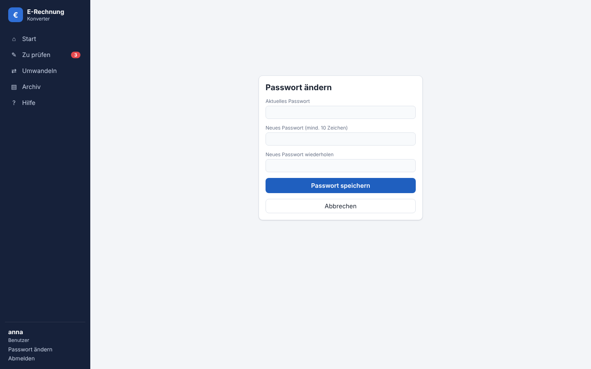

# Anwenderhandbuch

Der **E-Rechnung Konverter** macht aus Ihren Rechnungen gültige E-Rechnungen nach EN 16931:

- **ZUGFeRD / Factur-X**: ein PDF, in das die Rechnungsdaten als XML eingebettet sind. Der Empfänger kann es lesen wie bisher, seine Software liest die Daten automatisch.
- **XRechnung**: eine reine XML-Datei. Öffentliche Auftraggeber (Behörden, Stadtwerke …) verlangen dieses Format.

Viele Rechnungen erledigt die App **automatisch**. Sie werden nur gebraucht, wenn etwas fehlt oder unklar ist.

> **Kurz gesagt:** Auf der Startseite sehen Sie, ob etwas „Zu prüfen“ ist. Öffnen, fehlende Angaben ergänzen, „Erzeugen“ klicken – fertig.

## Anmelden

Öffnen Sie die Adresse der App im Browser und melden Sie sich mit Ihrem Benutzernamen und Passwort an. Die Zugangsdaten bekommen Sie von Ihrem Administrator.

- Bei der **ersten Anmeldung** müssen Sie ein eigenes Passwort festlegen (mindestens 10 Zeichen).
- Nach längerer Inaktivität werden Sie aus Sicherheitsgründen automatisch abgemeldet.
- Nach 5 falschen Versuchen ist die Anmeldung für 5 Minuten gesperrt.

## Die Startseite

Oben sehen Sie, was ansteht:

| Kachel | Bedeutung |
|---|---|
| **Zu prüfen** | Rechnungen, bei denen die Automatik Hilfe braucht. Ein Klick öffnet die Liste. Rot = es wartet etwas. |
| **Heute erzeugt** | Wie viele E-Rechnungen heute erstellt wurden. Ein Klick öffnet das Archiv. |
| **Automatik** | „läuft“ = SAP- und PDF-Eingang werden überwacht. „gestört“ = bitte den Administrator informieren. |

Darunter liegt die **Ablagefläche**: Ziehen Sie eine oder mehrere Rechnungen (PDF oder SAP-IDoc) hinein oder klicken Sie darauf.

### Kennzahlen und Diagramme

- **E-Rechnungen im laufenden Monat** und **Rechnungsvolumen** (brutto, in Euro) – mit Vergleich zum Vormonat bis zum selben Tag.
- **Automatisierungsquote**: Anteil der Rechnungen der letzten 30 Tage, die ohne einen Klick entstanden sind.
- **Ø Zeit bis zur Freigabe**: wie lange Rechnungen im Schnitt in „Zu prüfen“ lagen.
- **E-Rechnungen pro Tag** (automatisch / von Hand), **Volumen pro Monat**, **Formate und Quellen** und die **Top-Käufer**.

Fahren Sie mit der Maus über eine Säule, um die genauen Werte zu sehen. Über **„Tabelle“** rechts oben in jedem Diagramm sehen Sie die Zahlen als Liste.

## Eine Rechnung umwandeln

1. Klicken Sie links auf **Umwandeln** (oder ziehen Sie die Datei auf die Startseite).
2. Legen Sie die PDF-Rechnung oder das SAP-IDoc (`.xml`) ab.

Die App liest die Rechnung und zeigt links das **Original** und rechts die **erkannten Daten**:

3. Wählen Sie oben das Format: **ZUGFeRD** (Standard) oder **XRechnung** (für Behörden).
4. Prüfen Sie die Felder. Oben steht laufend, ob die Rechnung vollständig ist:
   - **✓ Bereit** – alles in Ordnung.
   - **„n Fehler“** – im roten Kasten steht, was fehlt. **„→ zum Feld“** springt direkt zur Stelle.
5. Klicken Sie auf **„ZUGFeRD erzeugen“** bzw. **„XRechnung erzeugen“**. Die Datei wird heruntergeladen und im Archiv gespeichert.

**Gut zu wissen**

- **Gescannte PDFs** (ohne Text) werden automatisch per Texterkennung gelesen. Prüfen Sie hier Zahlen und Namen besonders genau.
- **Summen** rechnet die App immer selbst nach. Weichen sie von den Beträgen auf dem PDF ab, erscheint eine Warnung.
- **Käuferdaten** wie E-Rechnungs-Adresse oder Leitweg-ID werden aus dem Kundenstamm (SAP) bzw. aus früheren Rechnungen ergänzt. Unter „Käufer“ können Sie über **„Aus Adressbuch übernehmen“** auch selbst suchen.
- Mit **„PDF ausblenden“** bekommt das Formular mehr Platz.
- Wechseln Sie ruhig zwischendurch die Seite – die angefangene Rechnung bleibt erhalten.

### Mehrere Rechnungen auf einmal (Stapel)

Legen Sie mehrere Dateien gleichzeitig ab. Fehlerfreie Rechnungen werden sofort umgewandelt; nur die mit Fehlern müssen Sie öffnen und korrigieren. Alle Ergebnisse lassen sich am Ende als ZIP-Datei herunterladen.

## Zu prüfen

Rechnungen aus dem automatischen Eingang (SAP und Scanner/Netzlaufwerk), bei denen etwas fehlt, landen in **Zu prüfen**. Die Zahl im Menü zeigt, wie viele warten.

- Die Spalte **„Was fehlt“** nennt den Grund, z. B. fehlende Käuferanschrift.
- **„Prüfung starten“** öffnet die älteste Rechnung. Nach dem Erzeugen öffnet sich automatisch die nächste.
- Ein Klick auf eine Zeile öffnet genau diese Rechnung.

Ergänzen Sie die rot markierten Felder und klicken Sie auf **„Erzeugen“**. Ist eine Rechnung doppelt oder ungültig, können Sie sie **verwerfen** – sie verschwindet dann aus der Liste (im Protokoll bleibt das nachvollziehbar).

## Archiv

Jede erzeugte E-Rechnung wird im Archiv gespeichert – egal ob von Hand oder automatisch.

- **Suche** nach Rechnungsnummer oder Käufer, Filter nach **Zeitraum**, **Format** und **Quelle**.
- **Herunterladen** lädt die E-Rechnung erneut herunter.
- Mehrere Einträge per Häkchen auswählen und gemeinsam als **ZIP** herunterladen.
- In der Spalte **„Von“** steht, wer die Rechnung erzeugt hat („worker“ = automatisch).

## Hilfe

Dieses Handbuch finden Sie jederzeit links unter **Hilfe**. Über das Inhaltsverzeichnis springen Sie zu einem Thema; **„Drucken / als PDF“** erstellt eine Druckfassung.

## Passwort ändern und abmelden

Unten links finden Sie **„Passwort ändern“** und **„Abmelden“**.

Haben Sie Ihr Passwort vergessen, kann ein Administrator es zurücksetzen. Sie vergeben dann bei der nächsten Anmeldung ein neues.

## Häufige Fragen

**Die Rechnung zeigt „Name des Käufers fehlt“, obwohl er auf dem PDF steht.**
Bei ungewöhnlichen Briefbögen oder schlechten Scans findet die Erkennung den Käufer nicht immer. Tragen Sie ihn ein oder übernehmen Sie ihn aus dem Adressbuch. Fällt das bei einem Layout häufig auf, kann der Administrator eine Vorlage dafür anlegen.

**Wann ZUGFeRD, wann XRechnung?**
Für Unternehmen genügt in der Regel ZUGFeRD. Öffentliche Auftraggeber verlangen meist XRechnung und eine **Leitweg-ID**.

**Was bedeutet „E-Rechnungs-Adresse“?**
Die E-Mail-Adresse, an die der Käufer E-Rechnungen empfangen möchte. Sie ist Pflicht für XRechnung.

**Ich habe aus Versehen eine falsche Rechnung erzeugt.**
Erzeugen Sie die korrigierte Rechnung neu. Für eine bereits verschickte Rechnung gilt das übliche Vorgehen (Storno/Gutschrift) – bitte mit der Buchhaltung abstimmen.

**Die Kachel „Automatik“ zeigt „gestört“.**
Bitte den Administrator informieren. Rechnungen gehen dabei nicht verloren; sie werden verarbeitet, sobald die Automatik wieder läuft.
