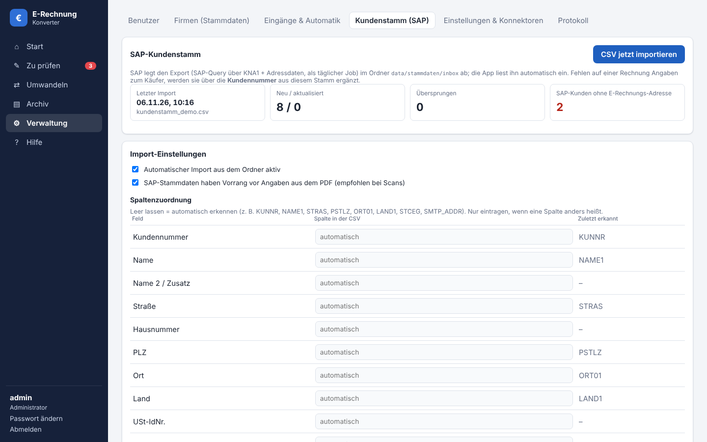
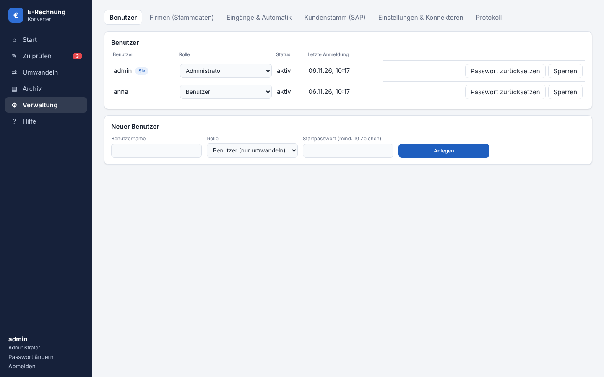
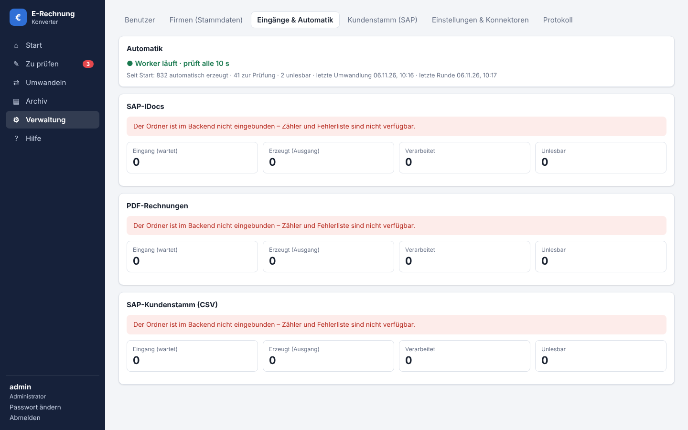
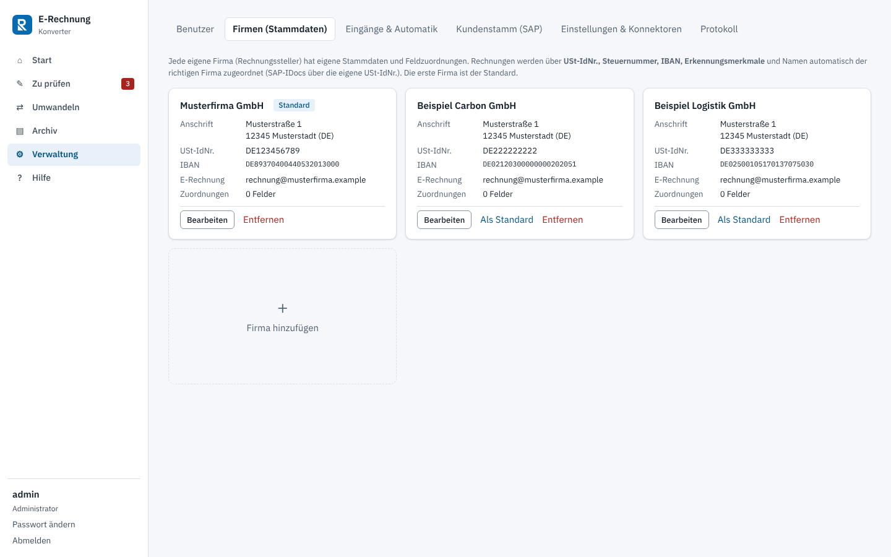
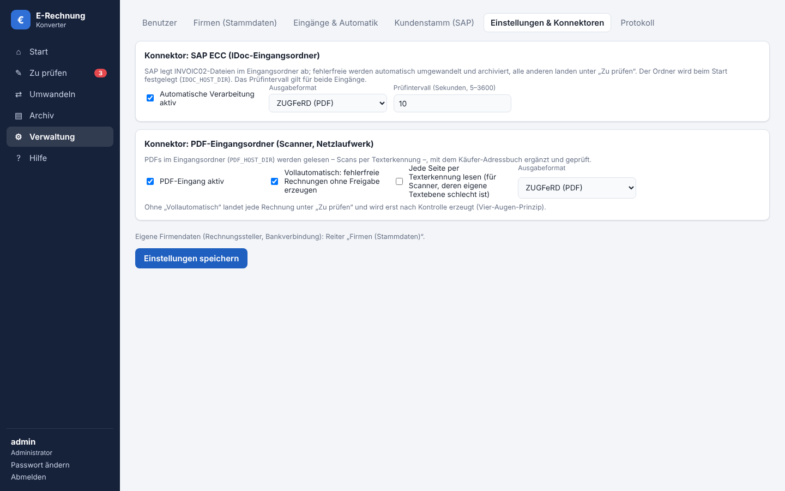
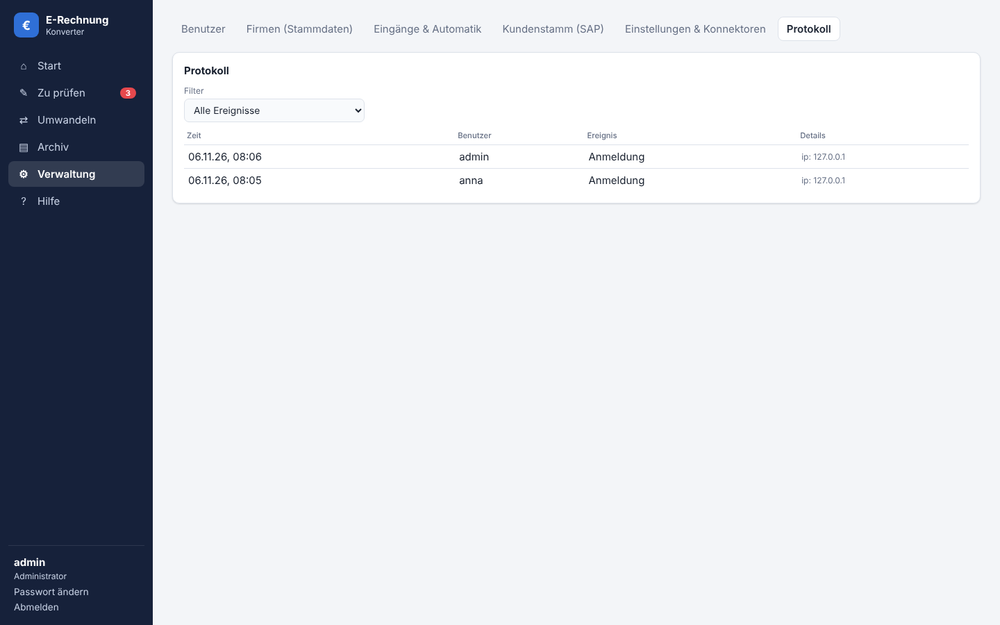

# Systemdokumentation

Diese Seite beschreibt Aufbau, Schnittstellen und Betrieb des E-Rechnung Konverters. Sie ist nur für Administratoren sichtbar. Die **Liste der REST-Endpunkte** am Ende wird automatisch aus dem laufenden System erzeugt und passt daher immer zur installierten Version.

## Überblick

Der Konverter erzeugt E-Rechnungen nach **EN 16931** aus drei Quellen:

| Quelle | Weg | Erkennung |
|---|---|---|
| PDF-Rechnung (auch Scan) | Upload oder PDF-Eingangsordner | regelbasiert (YAML-Vorlagen), Scans über OCR |
| SAP ECC | INVOIC02-IDoc (XML) per Upload oder IDoc-Eingangsordner | strukturiert, keine Texterkennung |
| Manuell | Formular in der Weboberfläche | – |

Ausgabeformate: **ZUGFeRD / Factur-X** (PDF/A-3 mit eingebettetem CII-XML, Profil EN 16931) und **XRechnung 3.0** (CII-XML).

Grundsätze der Verarbeitung:

1. **Ein neutrales Rechnungsmodell.** Jede Quelle erzeugt dasselbe Modell, jede Ausgabe liest es. Quellen und Ausgaben kennen sich nicht.
2. **Summen werden immer berechnet**, nie aus der Quelle übernommen. Aufgedruckte Summen dienen nur zum Abgleich.
3. **Export nur, wenn gültig.** Vor jedem Export läuft die Prüfung (EN-16931-Geschäftsregeln, XRechnung-Regeln, XSD).
4. **Automatik zuerst, Prüfung danach.** Gültige Eingänge werden ohne Klick umgewandelt; unvollständige landen in „Zu prüfen“, nie stillschweigend im Fehlerordner.

## Architektur und Dienste

Die Anwendung läuft als Docker-Compose-Stack. Jeder Dienst hat einen eigenen Container:

| Dienst | Aufgabe | Netz | Von außen |
|---|---|---|---|
| `frontend` | nginx: Weboberfläche (React), leitet `/api` ans Backend | web | ja (einziger veröffentlichter Port) |
| `backend` | FastAPI: Erkennung, Prüfung, Export, Archiv, Verwaltung | web, data | nein |
| `worker` | überwacht die Eingangsordner, wandelt automatisch um, importiert den Kundenstamm | data | nein, ohne Internet |
| `db` | PostgreSQL: Archiv, Benutzer, Einstellungen, Protokoll | data | nein, ohne Internet |
| `ocr` | Texterkennung für Scans (OCRmyPDF/Tesseract, Deutsch + Englisch) | data | nein, ohne Internet |
| `backup` | tägliche Datenbanksicherung (`pg_dump`) | data | nein, ohne Internet |

```
 Browser ──HTTPS──▶ [Reverse-Proxy] ──▶ frontend (nginx) ──/api──▶ backend ──┬──▶ db (PostgreSQL)
                                                                              └──▶ ocr
 SAP ECC ──IDoc-XML──▶ data/idoc/inbox ─┐
 Scanner ──PDF───────▶ data/pdf/inbox  ─┼──▶ worker ──▶ db / outbox/
 SAP-Query ──CSV─────▶ data/stammdaten ─┘
```

- Das Netz `data` ist **intern**: Worker, Datenbank, OCR und Backup haben keinen Internetzugang. Rechnungsdaten verlassen den Server nicht.
- Alle Namen (Container, Netze, Volumes, Images) hängen an `COMPOSE_PROJECT_NAME`; mehrere Stacks können auf einem Host laufen.
- `backend` und `worker` laufen als UID 10001 ohne Root-Rechte.

**Betriebsarten** (`deploy.sh`, gespeichert als `COMPOSE_FILE` in `.env`):

1. **Port** – nur `compose.yaml`, Weboberfläche auf `HTTP_PORT`.
2. **HTTPS mit Caddy** – `deploy/compose.https.yaml`, automatisches Let's-Encrypt-Zertifikat.
3. **Vorhandener Reverse-Proxy** (Nginx Proxy Manager, Traefik, nginx-proxy) – `deploy/compose.proxy.yaml`, das Frontend tritt dem Proxy-Netz unter dem Alias `<projekt>-web` bei.

## Schnittstellen

### Weboberfläche und REST-API

Die Oberfläche spricht ausschließlich über die REST-API unter `/api`. Regeln:

- **Anmeldung** über `POST /api/auth/login`; die Sitzung ist ein HttpOnly-Cookie (SameSite=Strict). Öffentlich sind nur `/api/health` und `/api/auth/login`.
- **Schreibende Anfragen** (POST/PUT/DELETE) brauchen den Header `X-Requested-With: erechnung` (CSRF-Schutz).
- **Rollen:** „angemeldet“ = jeder Benutzer, „Admin“ = nur Administratoren. Die Spalte *Zugriff* in der Endpunktliste unten zeigt das je Endpunkt.
- Fehler kommen als JSON `{"detail": …}`. Ein Export einer ungültigen Rechnung liefert **422** mit der Liste der Fehler.
- Die API ist während der Bearbeitung **zustandslos**: der Browser hält Rechnung und Original-PDF, gespeichert wird erst der fertige Export.

### SAP ECC – INVOIC02-IDoc (Rechnungen)

| | |
|---|---|
| Richtung | SAP → Konverter |
| Format | INVOIC02 als XML-Datei (Nachrichtenfindung + XML-Datei-Port) |
| Ablage | `IDOC_HOST_DIR/inbox` (Standard `data/idoc/inbox`) |
| Ergebnis | E-Rechnung in `outbox/`, IDoc nach `processed/`; unlesbare Dateien nach `error/` mit `.error.txt` |

Die ausstellende Firma wird über die eigene USt-IdNr. im IDoc (`E1EDK01`/`EIGENUINR`) bzw. den Namen des Partners `RS` bestimmt; ohne Treffer gilt die Standard-Firma.

Verwendete Segmente: `E1EDK01` (Währung, USt-IdNrn.), `E1EDKA1` (Partner: `RS` Rechnungssteller, `RE` Rechnungsempfänger), `E1EDK02` (Referenzen: `009` Rechnungsnr., `001` Bestellung), `E1EDK03` (Daten), `E1EDK18` (Zahlungsbedingungen), `E1EDP01` mit `E1EDP19/26/04` (Positionen, Beträge, Steuer). Die Zuordnung steht in `MAPPING` in `backend/app/erp/sap_ecc_idoc.py` und sollte mit einem echten IDoc aus dem System abgeglichen werden (WE02).

### SAP-Kundenstamm (CSV)

| | |
|---|---|
| Richtung | SAP → Konverter |
| Erzeugung | SAP-Query (SQVI/SQ01) über `KNA1` (+ `ADRC`/`ADR6`), täglicher Job (SM36) |
| Ablage | `STAMMDATEN_HOST_DIR/inbox` (Standard `data/stammdaten/inbox`) oder Upload in der Verwaltung |
| Format | CSV, Trennzeichen `;` `,` Tab oder `|`, UTF-8 oder Windows-1252, auch SAP-Listenausgabe |
| Schlüssel | Kundennummer (`KUNNR`), führende Nullen werden ignoriert |

Erkannte Spalten (Groß-/Kleinschreibung egal, abweichende Namen in der Verwaltung zuordnen):

| Feld | typische Spalten |
|---|---|
| Kundennummer | `KUNNR`, Kundennummer, Debitor |
| Name / Zusatz | `NAME1`, `NAME2` |
| Anschrift | `STRAS`, `HAUSN`, `PSTLZ`, `ORT01`, `LAND1` |
| USt-IdNr. | `STCEG` |
| E-Rechnungs-Adresse | `SMTP_ADDR`, E-Rechnung, Rechnungs-Mail |
| Leitweg-ID | Leitweg-ID (wird nur übernommen, wenn die Spalte im Export vorhanden ist) |
| Ansprechpartner | Ansprechpartner, `TELF1`, Kontakt-E-Mail |

Mit **„SAP-Stammdaten haben Vorrang“** (Standard) überschreiben die Stammdaten Werte, die aus einem PDF oder Scan gelesen wurden. Exporte überschreiben SAP-Kunden nie, sie füllen höchstens leere Felder.



### PDF-Eingang (Scanner / Netzlaufwerk)

`PDF_HOST_DIR/inbox` (Standard `data/pdf/inbox`). Gültige Rechnungen werden automatisch erzeugt (`outbox/` + Archiv), unvollständige gehen nach „Zu prüfen“, das Original nach `processed/`. Mit ausgeschalteter Vollautomatik geht jede PDF-Rechnung zur Freigabe („Vier-Augen-Prinzip“).

### OCR-Dienst (intern)

| Endpunkt | Beschreibung |
|---|---|
| `GET /health` | Status und installierte Sprachen |
| `POST /ocr` | PDF hochladen (multipart, Feld `file`), Antwort: PDF mit Textebene. Optional `pages` = `all` oder `1,3`: diese Seiten werden auch dann erkannt, wenn sie schon eine Textebene haben |

**Wann wird erkannt?** Pro Seite (`PdfText.scan_pages`): Seiten ohne Text, und Seiten, die überwiegend aus einem Bild bestehen und nur wenig oder unleserlichen Text tragen (Scanner-Stempel, schlechte Scanner-Texterkennung). Digitale Seiten bleiben unverändert. Im Editor erzwingt „Texterkennung erzwingen“ die Erkennung aller Seiten; für den PDF-Eingang gibt es dafür die Einstellung „Jede Seite per Texterkennung lesen“.

Nur im internen Netz erreichbar (`OCR_URL`, Standard `http://ocr:8000`). Ist der Dienst nicht erreichbar, werden Scans in „Zu prüfen“ gelegt statt verworfen.

## Systemfunktionen

| Funktion | Beschreibung | Technik |
|---|---|---|
| Erkennung | Felder aus PDF-Text per Regeln; neue Layouts = neue YAML-Datei, kein Code. Vorlagen für die Layouts von Rheinfelden Carbon, Alloys (Preis / 1000 KG) und Semis (englisch, Preis / 100 KG, steuerfreie Ausfuhr). OCR-Lesefehler bei Dezimalzeichen („2.640.00“) werden über die aufgedruckten Summen aufgelöst | `app/extraction/`, Vorlagen in `templates/` |
| Prüfung | EN-16931-Pflichtfelder, Summen, XRechnung-Regeln (z. B. BR-DE-15 Leitweg-ID), XSD | `app/validation.py`, `export/zugferd.py` |
| Export | CII-XML; für ZUGFeRD in PDF/A-3 eingebettet | `app/export/`, `app/convert.py` |
| Archiv | jede erzeugte Rechnung samt Datei in der Datenbank; Suche, ZIP-Download | Tabelle `documents` |
| Zu prüfen | Prüfliste für unvollständige automatische Eingänge, Original bleibt gespeichert | Tabelle `review_items` |
| Mehrere Firmen | bis zu 10 eigene Firmen (Rechnungssteller); Zuordnung eines Dokuments über USt-IdNr., Steuernummer, IBAN, Erkennungsmerkmale, Name; IDocs über `EIGENUINR` | Einstellung `companies`, `app/settings.py`, `app/recognize.py` |
| Feldverknüpfungen | Wert im PDF anklicken → Formularfeld; je Firma gespeichert und bei den nächsten Rechnungen angewendet (Bezug: Beschriftung neben/über dem Wert) | Tabelle `field_links`, `app/field_links.py` |
| Adressbuch / Kundenstamm | ergänzt Käuferdaten über Kundennummer bzw. Name | Tabelle `customers`, `app/customers.py`, `app/customer_import.py` |
| Kennzahlen | Startseite: Rechnungen pro Tag/Monat, Volumen, Automatisierungsquote, Prüfdauer | `GET /api/dashboard/stats` |
| Benutzer & Rollen | Benutzer/Administrator, Sperren, Passwort zurücksetzen | Tabellen `users`, `sessions` |
| Protokoll | Anmeldungen, Fehlversuche, Exporte, Downloads, Änderungen | Tabelle `audit_log` |
| Einstellungen | Firmendaten, Eingänge, Kundenstamm-Import | Tabelle `settings` |

### Datenbank

| Tabelle | Inhalt |
|---|---|
| `documents` | erzeugte E-Rechnungen (Metadaten, Rechnung als JSON, Datei) |
| `review_items` | Einträge in „Zu prüfen“ inkl. Fehlern und Original-PDF |
| `field_links` | Feldverknüpfungen je Firma: Feld, Seite, Rahmen in PDF-Punkten, Bezugsbeschriftung, Beispielwert |
| `customers` | Käufer-Adressbuch und SAP-Kundenstamm (`source` = `sap` / `rechnung`) |
| `users`, `sessions` | Benutzer (Argon2id-Hash) und Sitzungen (nur Hash des Tokens) |
| `settings` | Einstellungen als JSON: `companies`, `idoc`, `pdf_inbox`, `customer_import`, Statusmeldungen des Workers |
| `audit_log` | Protokoll sicherheitsrelevanter Aktionen |

Fehlende Spalten älterer Versionen werden beim Start ergänzt. Ohne `DATABASE_URL` (lokale Entwicklung) nutzt das Backend SQLite.

## Verwaltung



- **Benutzer:** anlegen, Rolle ändern, sperren, Passwort zurücksetzen. Neue und zurückgesetzte Benutzer müssen ihr Passwort bei der nächsten Anmeldung ändern. Der letzte aktive Administrator kann sich nicht selbst entfernen.
- **Eingänge & Automatik:** Status des Workers, Dateien je Ordner, fehlgeschlagene Dateien mit Grund und „Erneut verarbeiten“.



- **Firmen (Stammdaten):** die eigenen Firmen (Rechnungssteller) mit Anschrift, USt-IdNr., Bankverbindung, Zahlungsbedingungen und optionalen Erkennungsmerkmalen; die erste ist der Standard. Je Firma die gespeicherten **Feldverknüpfungen** (Feld, Beispielwert, Bezugsbeschriftung, wer) mit „Löschen“. Wird eine Firma entfernt, werden ihre Verknüpfungen beim Speichern gelöscht.



- **Kundenstamm (SAP):** letzter Import, Upload, Spaltenzuordnung, Kunden ohne E-Rechnungs-Adresse.
- **Einstellungen & Konnektoren:** IDoc- und PDF-Eingang (an/aus, Format, Intervall, Vollautomatik).



- **Protokoll:** wer wann was getan hat.



## Sicherheit

- Jeder Endpunkt außer `/api/health` und `/api/auth/login` verlangt eine Anmeldung; Verwaltung nur für Administratoren.
- Passwörter: Argon2id, mindestens 10 Zeichen. Sperre nach 5 Fehlversuchen für 5 Minuten.
- Sitzungen: HttpOnly-/SameSite=Strict-Cookie, Abmeldung nach `SESSION_IDLE_MINUTES` Inaktivität, spätestens nach `SESSION_MAX_HOURS`. Sperren eines Benutzers beendet seine Sitzungen sofort.
- CSRF-Schutz über den Pflicht-Header `X-Requested-With: erechnung` bei schreibenden Anfragen.
- Im Internet nur hinter HTTPS betreiben und `COOKIE_SECURE=true` setzen.
- Datenbank, Worker, OCR und Backup haben keinen Internetzugang.

## Konfiguration

Alle Werte stehen in `.env` (Vorlage `.env.example`). Firmendaten und Eingangs-Einstellungen werden nach dem ersten Speichern in der Verwaltung aus der Datenbank gelesen.

| Variable | Bedeutung | Standard |
|---|---|---|
| `COMPOSE_PROJECT_NAME` | Präfix aller Container, Netze, Volumes | `erechnung` |
| `COMPOSE_FILE` | Betriebsart (siehe oben) | `compose.yaml` |
| `POSTGRES_DB`, `POSTGRES_USER`, `POSTGRES_PASSWORD` | Datenbankzugang | – |
| `ADMIN_USER`, `ADMIN_PASSWORD` | erster Administrator (nur solange es keinen Benutzer gibt) | – |
| `COOKIE_SECURE` | Cookie nur über HTTPS | `false` |
| `SESSION_IDLE_MINUTES`, `SESSION_MAX_HOURS` | Sitzungsdauer | `60`, `12` |
| `HTTP_PORT` | Port der Weboberfläche | `8080` |
| `IDOC_HOST_DIR`, `PDF_HOST_DIR`, `STAMMDATEN_HOST_DIR` | Eingangsordner auf dem Host | `./data/…` |
| `IDOC_PROFILE`, `IDOC_INTERVAL` | Startwerte für Format und Abfrageintervall | `zugferd`, `10` |
| `BACKUP_HOST_DIR`, `BACKUP_TIME`, `BACKUP_KEEP_DAYS` | Sicherungen | `./backups`, `02:30`, `14` |
| `OCR_LANG`, `OCR_PARALLEL` | Sprachen und parallele Dokumente der Texterkennung | `deu+eng`, `2` |
| `STATS_TZ` | Zeitzone der Kennzahlen auf der Startseite | `Europe/Berlin` |

## Betrieb

```bash
./deploy.sh                          # installieren bzw. aktualisieren (git pull, Build, Neustart)
docker compose ps                    # Status aller Dienste
docker compose logs -f backend worker
docker compose exec backup /bin/sh /backup.sh now     # sofort sichern
docker compose exec backend python -m app.manage reset-password admin   # Notfall
```

**Überwachung:** Jeder Dienst hat einen Healthcheck. Der Worker gilt als gestört, wenn seit 60 Sekunden keine Runde fertig wurde (Startseite: Kachel „Automatik“). Das Backup gilt als gestört, wenn die neueste Sicherung älter als 26 Stunden ist.

**Sicherung:** täglich `pg_dump` nach `BACKUP_HOST_DIR`; zusätzlich auf ein anderes System kopieren. Die Eingangsordner gehören in die normale Dateisicherung.

**Wiederherstellung:**

```bash
docker compose stop backend worker
docker compose exec backup pg_restore --clean --if-exists --no-owner -d erechnung /backups/<datei>.dump
docker compose start backend worker
```

**Dokumentation pflegen:** Die Texte liegen in `backend/app/handbuch/` (Markdown). Screenshots erzeugt `frontend/scripts/screenshots.mjs` mit erfundenen Demo-Daten aus `backend/scripts/demo_data.py`.
